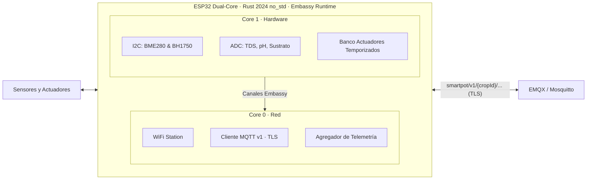

# SmartPot-IoT-Rust

## Estado del Proyecto

[](https://github.com/SmartPotTech/SmartPot-IoT-Rust/actions/workflows/ci.yml)

## Descripción

`SmartPot-IoT-Rust` es el **firmware de alto rendimiento en Rust** para el dispositivo de un cultivo real en la plataforma SmartPot. Diseñado en Rust 2024 bajo un entorno estricto `no_std`, aprovecha la arquitectura de doble núcleo (Dual-Core) del **ESP32** y el runtime asíncrono cooperativo **Embassy** para garantizar máxima velocidad, confiabilidad y seguridad de memoria sin depender de asignadores dinámicos pesados.

El dispositivo adquiere lecturas de 7 variables físicas (I2C y ADC), publica telemetría bajo el contrato MQTT v1 de SmartPot, ejecuta comandos remotos con temporizadores asíncronos y emite confirmaciones (ACK) con mensajes legibles en español.



## Características Principales

* **Rust 2024 `no_std`**: Código nativo para microcontroladores sin sobrecoste de biblioteca estándar ni riesgo de fragmentación de memoria en tiempo de ejecución.
* **Embassy Async Runtime**: Ejecución cooperativa de tareas y canales `PubSub` estáticos sin bloqueos (lock-free) para comunicación inter-núcleos.
* **Aislamiento Dual-Core**: Core 0 dedicado al stack de red WiFi y enlace MQTT v1; Core 1 dedicado al muestreo de sensores y control en tiempo real de actuadores.
* **Contrato MQTT v1 Completo**: Cumplimiento riguroso de tópicos, LWT retenido (`offline` / `online`), telemetría sin valores nulos y confirmaciones ACK en español.
* **Seguridad y Tipos Fuertes**: Serialización y deserialización sin asignaciones dinámicas (`heapless`), rechazando comandos inválidos con ACKs tipados.
* **Integración Nativa con `demo-beta`**: Totalmente compatible con la pila moderna de SmartPot (EMQX con autenticación HTTP sobre `SmartPot-API-Go`, TimescaleDB y SolidJS PWA).

## Asignación de Pines (Pinout)

| Componente | Pin ESP32 | Tipo | Variable / Función |
| --- | --- | --- | --- |
| **BME280** (SCL) | GPIO 22 | I2C Bus Principal (400 kHz) | Reloj I2C compartido |
| **BME280** (SDA) | GPIO 21 | I2C Bus Principal (400 kHz) | `temperature` (°C), `humidity` (%), `atmosphere` (hPa) |
| **BH1750** | I2C (22/21) | I2C (Dirección 0x23) | `brightness` (lux) |
| **Sensor TDS** | GPIO 34 | ADC1 CH6 (Atenuación 11dB) | `tds` (ppm) |
| **Sensor pH** | GPIO 35 | ADC1 CH7 (Atenuación 11dB) | `ph` (0.00 – 14.00) |
| **Humedad Sustrato** | GPIO 32 | ADC1 CH4 (Atenuación 11dB) | `soilMoisture` (%) |
| **Bomba de Agua** | GPIO 25 | Salida Digital | `WATER_PUMP` |
| **Luces de Cultivo** | GPIO 26 | Salida Digital | `LIGHTS` |
| **Ventilador** | GPIO 27 | Salida Digital | `FAN` |
| **Humidificador** | GPIO 5 | Salida Digital | `HUMIDIFIER` |

## Contrato MQTT v1

Prefijo canónico: `smartpot/v1/{cropId}/`

| Tópico | Sentido | QoS | Retenido | Propósito | Carga / Ejemplo JSON |
| --- | --- | --- | --- | --- | --- |
| `.../status` | Dispositivo → Broker | 1 | Sí | Estado del cultivo (LWT y conexión) | `"online"` / `"offline"` |
| `.../telemetry` | Dispositivo → Broker | 0 | No | Muestra agregada de variables físicas | `{"temperature":23.4,"humidity":64.8,"brightness":1850,"ph":6.85,"tds":620,"atmosphere":1012.8,"soilMoisture":48.2}` |
| `.../commands` | API → Dispositivo | 1 | No | Orden de actuación con duración opcional | `{"id":"cmd-1","actuator":"WATER_PUMP","action":"ACTIVATE","durationSeconds":15}` |
| `.../commands/ack` | Dispositivo → Broker | 1 | No | Confirmación de ejecución en español | `{"id":"cmd-1","status":"EXECUTED","message":"Bomba de agua encendida por 15 s"}` |

## Estructura del Proyecto

```text
SmartPot-IoT-Rust/
├── .cargo/
│   └── config.toml          # Opciones de compilación xtensa y rustflags
├── docs/
│   ├── diagrams/            # Diagramas Mermaid (.mmd) del componente
│   └── SmartPot_IoT_Rust_Documentation.md
├── src/
│   ├── bin/
│   │   └── main.rs          # Punto de entrada dual-core (Core 0 y Core 1)
│   ├── drivers/             # Controladores de hardware (TDS, pH, BME280, I2C)
│   ├── protocol/            # Contrato v1 (Topics, Telemetry, Command, ACK)
│   ├── tasks/               # Tareas asíncronas Embassy (WiFi, MQTT, Sensores, Actuadores)
│   ├── config.rs            # Configuración tipada del firmware
│   ├── events.rs            # Canales PubSub de eventos entre núcleos
│   └── lib.rs               # Exportaciones de biblioteca
├── tests/
│   └── verify_contract_v1.py # Suite de integración y validación contra demo-beta
├── diagram.json             # Circuito de Wokwi (sensores analógicos/I2C y actuadores LED)
├── wokwi.toml               # Configuración de simulación local en Wokwi
├── start.py                 # Script de arranque y verificación para simulación en Wokwi
├── Cargo.toml               # Dependencias embebidas y perfiles de compilación
├── README.md                # Este archivo
└── rust-toolchain.toml      # Canal "esp" (Rust 1.90.0-nightly para Xtensa)
```

## Simulación en Wokwi (Local, CLI y Plugins IDE)

Al igual que la versión base en MicroPython, `SmartPot-IoT-Rust` cuenta con soporte nativo para el simulador **[Wokwi](https://wokwi.com)**, permitiendo probar todo el ciclo de telemetría y actuación sin necesidad de hardware físico:

* **`diagram.json`**: Modela el circuito con la placa `board-esp32-devkit-c-v4`, los 3 potenciómetros ADC (TDS, pH, Sustrato), el sensor BME280 por I2C (GPIO 21/22) y los 4 LEDs indicadores con resistencias (Bomba, Luces, Ventilador, Humidificador).
* **`wokwi.toml`**: Configura a Wokwi para ejecutar el binario ELF compilado por Rust (`target/xtensa-esp32-none-elf/debug/smartpot-iot`).
* **Red virtual**: En Wokwi, la red WiFi predeterminada es `Wokwi-GUEST` (sin contraseña), que provee salida de red para comunicarse con el broker MQTT local o en la nube.

### Opciones de Ejecución en Wokwi

1. **Plugin de PyCharm / CLion (JetBrains)**:
   - Instala el plugin **Wokwi Simulator** desde `Settings -> Plugins`.
   - Abre el archivo `diagram.json` en el editor.
   - Presiona el botón verde de **Play** ("Start Simulation") en la barra superior del editor de diagrama.
2. **Extensión de VS Code**:
   - Instala la extensión **Wokwi Simulator**.
   - Presiona `F1` y selecciona `Wokwi: Start Simulator`.
3. **Wokwi CLI y script de inicio**:
   ```bash
   # Compila el ELF y arranca la simulación (o muestra instrucciones)
   python start.py
   ```
4. **Wokwi Web (wokwi.com)**:
   - Carga el archivo `diagram.json` y el binario ELF compilado.

> [!NOTE]
> `SmartPot-IoT-Rust` es un **firmware embebido** concebido para ejecutarse en microcontroladores físicos ESP32 o en el simulador Wokwi. **No forma parte del despliegue Docker de `demo-beta`** (en el servidor, la simulación masiva de cultivos virtuales para pruebas la realiza `SmartPot-DataGenerator-Rust`).

## Compilación y Grabación

### Requisitos
* Cadena de herramientas oficial de Espressif para Rust (`esp` channel):
  ```bash
  cargo +esp --version
  ```
* Herramienta `espflash` para flashear el microcontrolador:
  ```bash
  cargo install espflash
  ```

### Comandos de Construcción
```bash
# Verificación de sintaxis y tipos
cargo +esp check --ignore-rust-version

# Compilación del binario ejecutable
cargo +esp build --bin smartpot-iot --ignore-rust-version

# Grabación en placa física ESP32 y monitor serie defmt
espflash flash target/xtensa-esp32-none-elf/debug/smartpot-iot --monitor
```

## Pruebas de Integración con `demo-beta`

El firmware incluye una suite de pruebas automatizadas en `tests/verify_contract_v1.py` que comprueba:
1. Autenticación MQTT contra EMQX mediante el endpoint interno de `SmartPot-API-Go` (`/internal/mqtt/authn`).
2. Publicación y recepción de telemetría sin nulos.
3. Despacho y ejecución de comandos para los 4 actuadores con confirmaciones ACK en español.
4. Respuesta inmediata `FAILED` ante comandos inválidos.

Ejecutar la suite:
```bash
uv run --with paho-mqtt python tests/verify_contract_v1.py
```

## Documentación Completa

Para conocer todos los detalles técnicos, diseño del circuito y pruebas de validación, consulta:
* [Documentación Completa de SmartPot-IoT-Rust](docs/SmartPot_IoT_Rust_Documentation.md)
