<!-- portada
eyebrow: Documentación del componente
titulo: SmartPot-IoT-Rust
acento: IoT
subtitulo: Firmware de alto rendimiento para cultivo real en Rust
bajada: Rust 2024 no_std sobre ESP32 dual-core con Embassy: arquitectura asíncrona por tareas, canales libres de bloqueo, contrato MQTT v1 estricto con TLS, temporización exacta de actuadores y telemetría de 7 variables físicas.
documento: SmartPot-IoT-Rust
version: 1.0 · octubre 2026
equipo: SmartPotTech
proyecto: smartpot.app
-->

# SmartPot-IoT-Rust

## Ficha del documento

| Campo | Valor |
| --- | --- |
| Proyecto | SmartPot · [smartpot.app](https://smartpot.app) |
| Componente | [SmartPot-IoT-Rust](https://github.com/SmartPotTech/SmartPot-IoT-Rust) |
| Versión | 1.0 · octubre 2026 |
| Alcance | Arquitectura dual-core, Embassy async runtime, contrato MQTT v1, banco de actuadores temporizados, adquisición I2C/ADC y pruebas contra demo-beta |
| Documentación de la plataforma | [Documentación técnica](https://github.com/SmartPotTech/.github/blob/main/docs/SmartPot_Technical_Documentation.md), [recorrido del proyecto](https://github.com/SmartPotTech/.github/blob/main/docs/SmartPot_Project_Journey.md), [ciclo de vida](https://github.com/SmartPotTech/.github/blob/main/docs/SmartPot_Software_Lifecycle.md) y [diagramas generales](https://github.com/SmartPotTech/.github/blob/main/docs/README.md#diagramas-generales) |
| Mantenimiento | Se actualiza en conjunto con las especificaciones de hardware y el contrato MQTT de la plataforma |

<!-- parte: PARTE I | El componente -->

## 1. Propósito

### En palabras simples

`SmartPot-IoT-Rust` representa la evolución de alto rendimiento y máxima confiabilidad del firmware de dispositivo para cultivos reales en SmartPot. Frente a la implementación base en MicroPython, esta versión en Rust aprovecha al máximo el hardware del ESP32 mediante:
1. **Entorno `no_std` estricto**: Sin dependencias de sistema operativo pesado ni fragmentación de memoria dinámica en tiempo de ejecución.
2. **Concurrencia asíncrona con Embassy**: Despacho cooperativo ultrarrápido con microsegundos de latencia y uso óptimo de memoria RAM estática.
3. **Aislamiento en doble núcleo (Dual-Core)**: El Core 0 gestiona la pila de red (WiFi estación, TLS 1.2+ y cliente MQTT v1), mientras el Core 1 se dedica exclusivamente a la lectura de sensores (I2C y ADC) y al control de los actuadores físicos.
4. **Seguridad y tipos fuertes**: El contrato MQTT v1 se modela mediante enums y estructuras tipadas (`Command`, `SensorState`, `AckMessage`), garantizando que ningún mensaje mal formado cause un pánico o reinicio no controlado.

El dispositivo interactúa de forma nativa con los servicios de la plataforma (`EMQX`, `SmartPot-API-Go`, `SmartPot-DB` y `SmartPot-Web`), manteniendo total interoperabilidad y fidelidad con los cultivos reales y virtuales.

---

## 2. Arquitectura del componente

```mermaid
%%{init: {"theme": "base", "fontFamily": "Segoe UI, Arial, sans-serif", "themeVariables": {"fontFamily": "Segoe UI, Arial, sans-serif", "fontSize": "15px", "primaryColor": "#DDF5EA", "primaryTextColor": "#17261F", "primaryBorderColor": "#067A52", "secondaryColor": "#E3F2FB", "secondaryTextColor": "#17261F", "secondaryBorderColor": "#1F6FA0", "tertiaryColor": "#F2F7F4", "tertiaryTextColor": "#17261F", "tertiaryBorderColor": "#D5E3DC", "lineColor": "#5B6B63", "textColor": "#17261F", "mainBkg": "#DDF5EA", "nodeBorder": "#067A52", "clusterBkg": "#F7FAF8", "clusterBorder": "#D5E3DC", "edgeLabelBackground": "#FFFFFF", "actorBkg": "#067A52", "actorBorder": "#0B3D2B", "actorTextColor": "#FFFFFF", "actorLineColor": "#5B6B63", "signalColor": "#17261F", "signalTextColor": "#17261F", "labelBoxBkgColor": "#0B3D2B", "labelBoxBorderColor": "#0B3D2B", "labelTextColor": "#FFFFFF", "loopTextColor": "#0B3D2B", "noteBkgColor": "#FDF4DD", "noteBorderColor": "#C98D12", "noteTextColor": "#17261F", "activationBkgColor": "#DDF5EA", "activationBorderColor": "#067A52", "attributeBackgroundColorOdd": "#FFFFFF", "attributeBackgroundColorEven": "#F2F7F4"}, "layout": "elk", "elk": {"nodePlacementStrategy": "BRANDES_KOEPF", "mergeEdges": false, "cycleBreakingStrategy": "GREEDY"}}}%%
flowchart LR
  subgraph esp["ESP32 Dual-Core · Rust 2024 no_std · Embassy Runtime"]
    direction TB
    subgraph core0["Core 0 · Red y Comunicaciones"]
      direction TB
      wifi["tasks/wifi.rs<br/>WiFi Station · Reintentos"]
      mqtt["tasks/mqtt.rs<br/>Cliente MQTT v1 · TLS 1.2+<br/>LWT retenido · select3 loop"]
      telem["tasks/wifi.rs: telemetry_task<br/>Agregación · SensorState"]
    end

    subgraph core1["Core 1 · Adquisición y Control"]
      direction TB
      i2c["tasks/sensors.rs: bme280 & bh1750<br/>Temperatura, Humedad, Presión, Lux"]
      adc["tasks/sensors.rs: analog_sensors<br/>TDS, pH, Humedad Sustrato"]
      act["tasks/command.rs: actuator_task<br/>Bomba, Luces, Ventilador, Humidificador<br/>Temporizador Instant::now() + Duration"]
    end

    subgraph channels["Canales Estáticos Embassy (Sin Bloqueos)"]
      direction TB
      sch["SENSOR_CH<br/>Mediciones físicas"]
      cch["COMMAND_CH<br/>Órdenes entrantes"]
      ach["ACK_CH<br/>Confirmaciones en español"]
      tch["TELEMETRY_CH<br/>Payloads v1 sin nulos"]
    end
  end

  subgraph hw["Periféricos y Circuito"]
    direction TB
    sens["I2C SCL 22 / SDA 21<br/>ADC GPIO 34, 35, 32"]
    outs["Bomba 25 · Luces 26<br/>Ventilador 27 · Humidificador 5"]
  end

  broker["EMQX Broker / Mosquitto<br/>mqtt.smartpot.app:8883"]

  sens --> i2c & adc
  act --> outs

  i2c & adc -->|"produce mediciones"| sch
  sch -->|"consume y agrega"| telem
  telem -->|"emite JSON v1"| tch
  tch -->|"publica en bus"| mqtt

  mqtt <-->|"smartpot/v1/{cropId}/..."| broker
  mqtt -->|"despacha orden válida"| cch
  cch -->|"ejecuta y temporiza"| act
  act -->|"emite ACK"| ach
  ach -->|"publica confirmación"| mqtt

  classDef leaf fill:#DDF5EA,stroke:#067A52,color:#17261F
  classDef water fill:#E3F2FB,stroke:#1F6FA0,color:#17261F
  classDef sun fill:#FDF4DD,stroke:#C98D12,color:#17261F
  classDef clay fill:#FBE9E1,stroke:#B85A38,color:#17261F
  classDef core fill:#067A52,stroke:#0B3D2B,color:#FFFFFF
  classDef deep fill:#0B3D2B,stroke:#06281C,color:#FFFFFF
  classDef muted fill:#F2F7F4,stroke:#5B6B63,color:#17261F
  class mqtt,act core
  class broker deep
```

<!-- diagrama: SmartPot_IoT_Rust_Global_Component | titulo=SmartPot-IoT-Rust por dentro | lamina=H -->


---

## 3. Asignación de Pines y Periféricos

| Periférico | Pin ESP32 | Función / Protocolo | Variable / Métrica |
| --- | --- | --- | --- |
| **BME280** (SCL) | GPIO 22 | I2C Bus Principal (400 kHz) | Reloj I2C compartido |
| **BME280** (SDA) | GPIO 21 | I2C Bus Principal (400 kHz) | `temperature` (°C), `humidity` (%), `atmosphere` (hPa) |
| **BH1750** | I2C (22/21) | I2C (Dirección 0x23) | `brightness` (lux) |
| **Sensor TDS** | GPIO 34 | ADC1 Canal 6 (Atenuación 11dB) | `tds` (ppm, compensado) |
| **Sensor pH** | GPIO 35 | ADC1 Canal 7 (Atenuación 11dB) | `ph` (escala 0.00 – 14.00) |
| **Humedad Sustrato** | GPIO 32 | ADC1 Canal 4 (Atenuación 11dB) | `soilMoisture` (% volumétrico) |
| **Bomba de Agua** | GPIO 25 | Salida Digital (Push-Pull) | `WATER_PUMP` |
| **Luces de Cultivo** | GPIO 26 | Salida Digital (Push-Pull) | `LIGHTS` |
| **Ventilador** | GPIO 27 | Salida Digital (Push-Pull) | `FAN` |
| **Humidificador** | GPIO 5 | Salida Digital (Push-Pull) | `HUMIDIFIER` |

---

## 4. Contrato MQTT v1

El firmware se comunica bajo el prefijo canónico `smartpot/v1/{cropId}/`:

| Tópico | Sentido | QoS | Retenido | Propósito | Carga / Ejemplo JSON |
| --- | --- | --- | --- | --- | --- |
| `.../status` | Dispositivo → Broker | 1 | Sí | Estado del cultivo (LWT y conexión) | `"online"` / `"offline"` |
| `.../telemetry` | Dispositivo → Broker | 0 | No | Muestra agregada de 7 variables físicas | `{"temperature":23.4,"humidity":64.8,"brightness":1850,"ph":6.85,"tds":620,"atmosphere":1012.8,"soilMoisture":48.2}` |
| `.../commands` | API → Dispositivo | 1 | No | Orden de actuación con duración opcional | `{"id":"cmd-1","actuator":"WATER_PUMP","action":"ACTIVATE","durationSeconds":15}` |
| `.../commands/ack` | Dispositivo → Broker | 1 | No | Confirmación de ejecución en español | `{"id":"cmd-1","status":"EXECUTED","message":"Bomba de agua encendida por 15 s"}` |

### Reglas de Serialización y Deserialización
1. **Telemetría sin nulos**: Si un sensor no responde o falla su lectura, el campo se omite por completo del JSON para no alterar el promedio en la base de datos ni provocar errores de deserialización.
2. **Redondeo exacto**: 
   - `brightness` y `tds`: enteros (`1850`, `620`).
   - `ph`: 2 decimales (`6.85`).
   - `temperature`, `humidity`, `atmosphere`, `soilMoisture`: 1 decimal (`23.4`, `64.8`, `1012.8`, `48.2`).
3. **Formato humano de duración**: En los ACKs, los tiempos en segundos se expresan como:
   - `< 60 s`: `"{n} s"` (ej. `15 s`).
   - Múltiplos de 60 s: `"{n} min"` (ej. `10 min`).
   - Múltiplos de 3600 s: `"{n} h"` (ej. `2 h`).

---

## 5. Control de Actuadores y Temporización Asíncrona

Cada actuador posee un estado independiente `ActuatorRuntime`:
- **Encendido permanente**: Se activa el pin GPIO en nivel alto y se marca `active = true`, `deadline = None`.
- **Encendido temporizado**: Se activa el pin GPIO en nivel alto y se establece `deadline = Some(Instant::now() + Duration::from_secs(secs))`.
- **Bucle de supervisión**: La tarea `actuator_task` inspecciona periódicamente los plazos activos. Cuando `Instant::now() >= deadline`, apaga automáticamente el pin digital sin bloquear la recepción de nuevas órdenes.

---

## 6. Configuración y Compilación

### Variables de Compilación
El firmware puede configurarse en tiempo de compilación mediante variables de entorno o mediante valores por defecto:
- `SMARTPOT_WIFI_SSID`: Nombre de la red Wi-Fi (por defecto: `"SmartPot-WiFi"`).
- `SMARTPOT_WIFI_PASS`: Clave de la red Wi-Fi (por defecto: `"smartpot2026"`).
- `SMARTPOT_BROKER_HOST`: Host del broker MQTT (por defecto: `"127.0.0.1"` para demo-beta o `"mqtt.smartpot.app"` para producción).
- `SMARTPOT_BROKER_PORT`: Puerto MQTT (por defecto: `1883` o `8883` con TLS).
- `SMARTPOT_CROP_ID`: ID del cultivo asignado (Hex 24 caracteres, ej. `"66f5a1000000000000000101"`).
- `SMARTPOT_DEVICE_KEY`: Clave secreta del dispositivo para autenticación contra EMQX.
- `SMARTPOT_USE_TLS`: Habilitación de TLS 1.2+ (`"true"` o `"false"`).

### Comandos de Construcción
```bash
# Verificación de sintaxis y tipos
cargo +esp check --ignore-rust-version

# Compilación del binario ejecutable
cargo +esp build --bin smartpot-iot --ignore-rust-version

# Grabación en placa física ESP32
espflash flash target/xtensa-esp32-none-elf/debug/smartpot-iot --monitor
```

---

## 7. Verificación de Integración contra `demo-beta`

El firmware fue validado de extremo a extremo mediante el script automatizado `tests/verify_contract_v1.py` contra el entorno Docker activo de `demo-beta`:
1. **Autenticación HTTP de EMQX**: EMQX consulta a `SmartPot-API-Go` (`POST /internal/mqtt/authn`), validando el usuario `{cropId}` y contraseña `{deviceKey}`, recibiendo el ACL específico.
2. **Recepción y Ejecución de Comandos**: Se emitieron órdenes para los 4 actuadores (`WATER_PUMP`, `LIGHTS`, `FAN`, `HUMIDIFIER`), comprobando la emisión inmediata de ACKs `EXECUTED` con la duración formateada.
3. **Rechazo de Comandos Inválidos**: Comandos con actuadores inexistentes provocan la respuesta inmediata `FAILED` con mensaje `"Comando inválido o actuador desconocido"`.
4. **Ingesta de Telemetría**: Las muestras publicadas en `smartpot/v1/{cropId}/telemetry` son procesadas por la API Go y persistidas en TimescaleDB.

---

## 8. Simulación en Wokwi (diagram.json y wokwi.toml)

De la misma manera que la versión previa en MicroPython, `SmartPot-IoT-Rust` está preparado para simularse de forma fidedigna en [Wokwi](https://wokwi.com):
- **`diagram.json`**: Modela el esquema físico conectando el ESP32 con potenciómetros para las entradas analógicas ADC1 (TDS en GPIO 34, pH en GPIO 35, sustrato en GPIO 32), bus I2C para BME280 (SDA 21 / SCL 22) y 4 LEDs indicadores con resistencias para los actuadores (GPIO 25, 26, 27 y 5).
- **`wokwi.toml`**: Apunta directamente al binario compilado por Rust `target/xtensa-esp32-none-elf/debug/smartpot-iot`.
- **Ejecución local**:
  * **PyCharm / CLion (JetBrains)**: Con el plugin oficial *Wokwi Simulator*, abriendo `diagram.json` e iniciando la simulación gráfica con el botón de reproducción verde.
  * **VS Code**: Con la extensión *Wokwi Simulator* (`F1` -> *Wokwi: Start Simulator*).
  * **Script de inicio**: Mediante `python start.py` para compilación y arranque automatizado.

> [!NOTE]
> `SmartPot-IoT-Rust` es un **firmware para microcontroladores físicos o simulación Wokwi**, no un servicio contenedor en el docker compose de `demo-beta`. La simulación en servidor de cultivos virtuales para la plataforma la provee `SmartPot-DataGenerator-Rust`.
